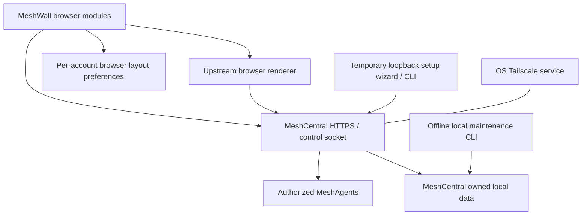

# Architecture — current alpha

The initial modular-monolith proposal (ADR 0001) is superseded for alpha by [ADR 0002](docs/adr/0002-same-origin-ui.md). MeshWall is a lightweight, same-origin static application served by pinned MeshCentral 1.3.2. There is no persistent second backend, SQLite service or server-side transcoder.

## Actual module map

| Path (under apps/web/public/meshwall/) | Responsibility |
| --- | --- |
| app.mjs | Shell, session lifecycle, inventory orchestration |
| control.mjs | Authenticated upstream socket, correlation, bounded request timeout |
| model.mjs | Pure layout, inventory, quality and retry logic |
| wall.mjs / tile-view.mjs | Tile scheduler, selected-device controls, presentation |
| desktop.mjs | Pinned upstream view-only renderer adapter and cleanup |
| management.mjs | Device and group management, enrollment |
| admin.mjs / account-view.mjs / accounts.mjs | Account and group membership, activity, diagnostics; validation separated from DOM |
| panels.mjs | Official same-origin compatibility panels |
| ui.mjs / style.css | Shared DOM helpers and design tokens |

`installers/linux/` owns bootstrap, shared config generation, Linux install, TLS renewal and the Linux wizard adapter. `installers/windows/` owns Windows provisioning, optional WinGet bootstrap, service identity and TLS renewal. `installers/setup/` owns the shared temporary loopback server, validation, read-only adoption planning, child-process runner and UI assets; OS entrypoints supply only preflight and installer adapters. `installers/adopt.mjs` copies only the owned static files into a supported existing installation. `scripts/maintenance/` owns offline backup/restore, TLS certificate swaps and UI release swaps. Tests are split into unit and integration/browser fixtures.

## Ownership and trust

The engine authenticates each browser session and enforces authoritative permissions and consent. No global admin credential is substituted. Layout preferences reside in localStorage per account, not the engine database. Screen data is not recorded. The setup helper is temporary, loopback-only, token-protected; privileged maintenance stays local. Tailscale is installed as an OS service, not bundled into MeshWall.

## Evolution

Keep dependency direction from UI toward pure feature logic and compatibility adapters. Avoid cross-feature mutable state, duplicate authentication or speculative runtimes. A persistent privileged helper, API gateway, database migrations or platform-specific service manager are future designs requiring separate review and ADRs. No claim of TypeScript build or SQLite migration in the current plain-JavaScript implementation.
