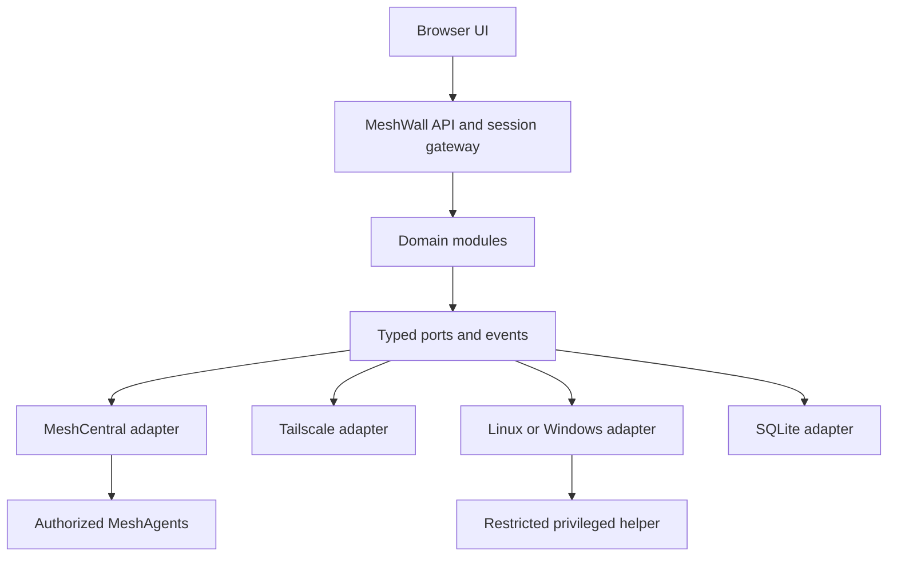

# Architecture

## Decision
Modular monolith: one MeshWall backend process, static browser UI, separate MeshCentral engine and Tailscale OS service. A narrowly scoped privileged helper performs approved installation and service operations. No server-side video transcoding.



## Repository layout (planned)
```text
apps/web/src/{core,shared,modules}
apps/server/src/{core,modules}
packages/{contracts,meshcentral-adapter,tailscale-adapter,streaming-engine,platform-linux,platform-windows,database}
installers/{linux,windows}
tests/{unit,integration,performance}
docs/adr/
```

Domain modules: setup, auth, overview, devices, groups, wall, desktop, terminal, files, enrollment, users, audit, health, backup, settings. Each owns its routes, use cases, schemas, tests and public exports. UI module: components, hooks, services, types, tests and index. Avoid global mutable state and cross-module database access; communicate via explicit contracts or bounded in-process events.

## Dependency direction
UI -> typed API client -> domain application service -> domain ports <- adapters. Core registers modules and lifecycle; adapters must not import UI or feature internals. Validate input at every trust boundary. Keep infrastructure failures isolated with timeouts and bounded retries.

## Lifecycle
Bootstrap detects OS and architecture; setup validates and provisions services; readiness requires authentication and an authorized session test. Runtime supervises connection health; shutdown stops new sessions and drains existing ones. Migration operations are transactional and reversible where possible.

## Resource strategy
Build UI off-device, lazy load features, bound queues/cache/concurrency, use SQLite with short transactions and retention, avoid redundant polling and decoding on STB. No mandatory container runtime. Pin supported engine versions. Linux systemd / Windows service adapters share a common interface.

## Data ownership
MeshCentral owns devices, groups, users and authoritative remote access. MeshWall stores UI preferences, layout, local configuration references, jobs and audit metadata. Do not copy upstream credentials into UI state. See docs/API-DATA.md.

## Evolution
Use ADRs for changes to boundaries, security model, persistence or deployment. Add automated checks for circular/deep imports. Replace adapters without rewriting domain modules.
